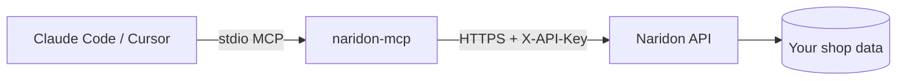

The **Naridon MCP server** exposes 45 tools for AI visibility, optimization, content management, and the Naridon Shop catalog — usable from any AI tool that speaks the [Model Context Protocol](https://modelcontextprotocol.io).

Once connected, you can ask your AI tool things like:

- *"What's my current visibility score?"*
- *"Show me pending optimization fixes and apply the safe ones."*
- *"Create a blog post about our new product launch and publish it."*
- *"Run a fresh scan and report what changed."*
- *"What content gaps do I have compared to competitors?"*

<CardGroup cols={2}>
  <Card title="Quickstart" icon="rocket" href="/integrations/mcp/quickstart">
    Get connected in under 60 seconds with one command.
  </Card>
  <Card title="Manual setup" icon="gear" href="/integrations/mcp/manual-setup">
    Edit your AI tool's MCP config by hand.
  </Card>
  <Card title="Tools reference" icon="wrench" href="/integrations/mcp/tools-reference">
    Every tool the server exposes, grouped by area.
  </Card>
  <Card title="Troubleshooting" icon="circle-question" href="/integrations/mcp/troubleshooting">
    Common errors and what to do about them.
  </Card>
</CardGroup>

## Supported AI tools

<CardGroup cols={3}>
  <Card title="Claude Code" icon="terminal" />
  <Card title="Cursor" icon="code" />
  <Card title="Windsurf" icon="wind" />
  <Card title="Claude Desktop" icon="comment" />
  <Card title="Cline (VS Code)" icon="puzzle-piece" />
  <Card title="Continue.dev" icon="forward" />
</CardGroup>

Any MCP-compatible client works — these are just the ones with auto-detect support in the installer.

## How it works

The MCP server runs locally on your machine via `npx`. It speaks MCP over stdio with your AI tool, and HTTPS to Naridon's API. Your **per-shop API key** authenticates the requests — the server resolves your shop automatically from the key, so you never have to type a shop ID.

## Security

- Per-shop API keys are scoped — pick the smallest set of permissions a key needs
- Keys can be revoked any time from **Settings → API Keys**
- The server only sends data to Naridon's API; nothing goes to third parties
- The optional CLI installer uses **loopback OAuth** — your raw key is never copied to the dashboard's JavaScript

## Next

<Card title="Quickstart" icon="rocket" href="/integrations/mcp/quickstart" arrow>
  One-command install with browser-based authentication.
</Card>
